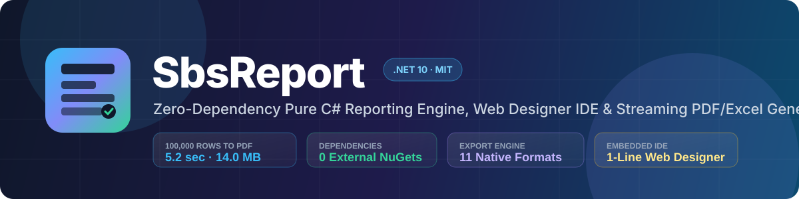
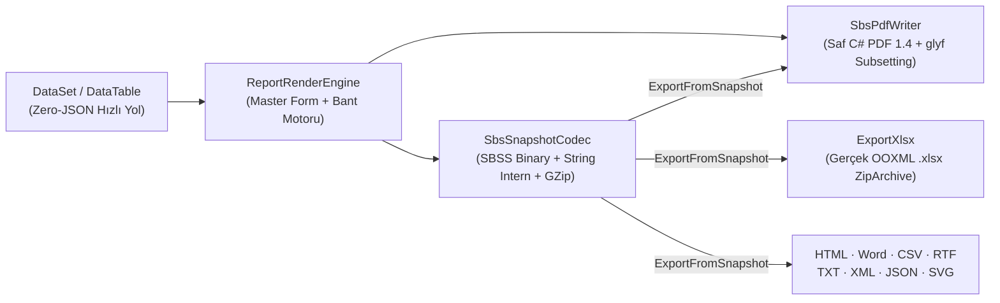

<div align="center">



<br/><br/>

[](https://www.nuget.org/packages/SbsReport)
[](https://www.nuget.org/packages/SbsReport)
[](https://dotnet.microsoft.com/)
[](#-neden-sbsreport)
[](LICENSE)
[](https://github.com/iventhosting/SbsReport/stargazers)

<h3>
  🚀 Sıfır harici bağımlılıklı, saf C# .NET 10 raporlama motoru, gömülü <b>Web Designer IDE</b> ve <b>100.000 satırı 5.2 saniyede</b> PDF/Excel'e çeviren kurumsal baskı kütüphanesi.
</h3>

<p>
  <a href="#-hızlı-başlangıç"><b>⚡ Hızlı Başlangıç</b></a> ·
  <a href="#-performans-benchmark-3836--100000-satır"><b>📊 Benchmarklar</b></a> ·
  <a href="#-gömülü-web-designer-ide"><b>🎨 Web Designer</b></a> ·
  <a href="#-11-yerel-dışa-aktarma-formatı"><b>📦 Export Formatları</b></a> ·
  <a href="#-detaylı-dokümantasyon"><b>📖 Dokümantasyon</b></a>
</p>

</div>

---

## ✨ Neden SbsReport?

Kurumsal .NET projelerinde raporlama için yüksek lisans bedelleri ödemek, Chromium/wkhtmltopdf süreçleri yönetmek veya SkiaSharp/GDI+ native DLL bağımlılıklarıyla uğraşmak zorunda değilsiniz.

| Özellik | SbsReport | Geleneksel Ticari / Native Motorlar |
| :--- | :---: | :---: |
| **Harici NuGet / Native Bağımlılık** | ✅ **0 (Saf C# .NET 10)** | ❌ Skia / Chromium / GDI+ / Lisans DLL |
| **Lisans & Maliyet** | ✅ **%100 Açık Kaynak (MIT)** | ❌ Yüksek geliştirici/sunucu lisansı |
| **Gömülü Web Designer IDE** | ✅ **Tek satır `app.UseSbsReport()`** | ⚠️ Ayrı paket / ek ücret |
| **PDF Boyutu (TrueType Subsetting)** | ✅ **24.9 KB** (1 syf) · **590 KB** (3.8k satır) | ⚠️ 49 KB – 3+ MB |
| **Gerçek OOXML Excel (`.xlsx`)** | ✅ **Uyarı vermeden doğrudan açılır** | ⚠️ Sıklıkla 3. parti kütüphane gerekir |
| **100.000 Satır Stres Performansı** | ✅ **5.2 sn · 1.59 GB RAM · 14.0 MB PDF** | ❌ 11–15+ sn · 9+ GB RAM |
| **İkili Snapshot (`.sbsdoc`)** | ✅ **316 KB** (3.8k) · **7.98 MB** (100k) | ❌ 8.6 MB – 225+ MB |
| **Tam Türkçe Karakter & Arama** | ✅ **1-Byte Win1254 + Unicode CID + `/ToUnicode`** | ⚠️ Encoding / font sorunları |

---

## 📊 Performans Benchmark (`3.836` & `100.000` Satır)

Gerçek 9 kolonlu kurumsal personel listesi + Master Header/Footer şablonu üzerinde, `.NET 10 Release` derlemesiyle ölçülmüştür:

| Senaryo | Cold-Start | Warm Baskı | Snapshot → PDF | Snapshot → Excel (`.xlsx`) | Bellek (GC Alloc) | Snapshot Boyutu | PDF Boyutu |
| :--- | :---: | :---: | :---: | :---: | :---: | :---: | :---: |
| **Tek Sayfa Form (1 Kayıt)** | ~120 ms | ~18 ms | ~10 ms | ~8 ms | **~2 MB** | **1.6 KB** | **24.9 KB** |
| **Orta/Büyük Liste (3.836 Satır · 226 Syf)** | **554 ms** | **276 ms** | **184 ms** | **162 ms** (`208 KB`) | **64.1 MB** | **316 KB** | **590.7 KB** |
| **Ağır Stres Testi (100.000 Satır · 5.883 Syf)** | **5.20 sn** | **5.15 sn** | **3.95 sn** | **2.09 sn** (`5.23 MB`) | **1.59 GB** | **7.98 MB** | **14.04 MB** |

> 💡 **Sıfır Kayıplı Snapshot:** İlk üretilen PDF ile sonradan `ExportFromSnapshot(snap, "pdf")` üzerinden üretilen PDF **%100 byte-byte aynıdır**. Veritabanını tekrar sorgulamadan tek snapshot'tan anında PDF, Excel (`.xlsx`), Word, HTML veya CSV alabilirsiniz.

---

## 🏗️ Mimari Akış



---

## ⚡ Hızlı Başlangıç

### 1. NuGet Paketini Kurun

```bash
dotnet add package SbsReport
```

### 2. ASP.NET Core `Program.cs` Entegrasyonu (2 Satır)

```csharp
using SbsReport;

var builder = WebApplication.CreateBuilder(args);

builder.Services.AddSbsReport(options =>
{
    options.ReportsDirectory = Path.Combine(builder.Environment.ContentRootPath, "Reports");
    options.RoutePrefix = "/sbs-report";
    // Opsiyonel: Üretim ortamında oturum/politika zorunluluğu
    // options.RequireAuthorization = true;
    // options.AuthorizationPolicy = "ReportManagement";
});

var app = builder.Build();
app.UseSbsReport(); // Web Designer IDE & Viewer hazır!
app.Run();
```

Tarayıcınızdan **`/sbs-report`** adresine gidin — gömülü Web Designer IDE anında açılır.

### 3. C# Kodundan Headless Rapor Basma (`DataSet` → PDF & Excel)

```csharp
using System.Data;
using SbsReport.Services;

// 1. Tek seferde Snapshot + PDF üret (Zero-JSON DataSet hızlı yolu)
var (snapshotBytes, pdfBytes) = sbsEngine.RenderHeadless(
    reportTemplatePath: "Reports/sozlesmeli_personel_listesi.sbs",
    parameters: new Dictionary<string, object> { ["KurumAdi"] = "İl Sağlık Müdürlüğü" },
    dataSet: myDataSet);

// 2. Veritabanına tekrar gitmeden Snapshot'tan anında Excel (.xlsx), Word veya HTML al!
byte[] excelBytes = sbsEngine.ExportFromSnapshot(snapshotBytes, "xlsx");
byte[] htmlBytes  = sbsEngine.ExportFromSnapshot(snapshotBytes, "html");
```

---

## 🎨 Gömülü Web Designer IDE

Tek bir NuGet paketiyle uygulamanızın içine gömülen tam teşekküllü sürükle-bırak rapor tasarımcısı:

- **Bant Mimarisi:** `ReportTitle`, `PageHeader`, `GroupHeader`, `Header`, `Data`, `Table`, `HierarchicalData`, `Footer`, `GroupFooter`, `ReportSummary`, `PageFooter` — **sürükle-bırak ile bant sıralama**, klavye okları (`↑`/`↓`, `Shift+↑/↓`) ve fare tutamacıyla **üst üste binmeyen yükseklik ayarlama**.
- **Master Form Kalıtımı:** Kurumsal antet ve altbilgiyi tek bir Master şablonda (`IsMasterTemplate = true`) tanımlayın; tüm raporlar otomatik miras alsın.
- **16 Bileşen:** Metin, Giriş Kutusu, Onay Kutusu, Radyo, Açılır Liste, Tarih Seçici, İmza, Buton, Resim/Logo (Base64 PNG/JPG), Şekil, Çizgi, Barkod/QR, Grafik, Etkileşimli Tablo (`+Satır/+Sütun`), Panel.
- **Modern UX:** Çoklu sayfa sekmeleri, cetveller, akıllı hizalama çizgileri, canlı **Önizleme & PDF Önizleme**, Açık/Koyu tema, canlı **TR / EN** dil desteği ve **Türkçe duyarsız veri eşleştirme** (`{Data.Ünvan}` ↔ `UNVAN`).

---

## 📦 11 Yerel Dışa Aktarma Formatı

| Format | Uzantı | Özellik |
| :--- | :---: | :--- |
| **PDF 1.4** | `.pdf` | Saf C# `SbsPdfWriter`, TrueType `glyf/loca` font subsetting, 1-byte Türkçe Win1254 + Unicode CID, `/ToUnicode` |
| **Excel** | `.xlsx` | Gerçek ECMA-376 OOXML ZIP paketi (`ZipArchive`), uyarı vermeden açılır, kalın/kenarlık stilli, `inlineStr` korumalı |
| **Word** | `.doc` | Ofis uyumlu HTML/Word çıktısı, tablo ve sayfa sonu destekli |
| **HTML5** | `.html` | Birebir `mm` koordinatlı, `@media print` + `print-color-adjust: exact` yazdırma destekli |
| **Snapshot** | `.sbsdoc` | `SBSS` ikili format + String Interning + GZip (28x daha küçük) |
| **CSV** | `.csv` | UTF-8 BOM + `;` ayraç (Türkçe Excel doğrudan bozulmadan açar) |
| **RTF / TXT / XML / JSON / SVG** | `.rtf` `.txt` `.xml` `.json` `.svg` | Entegrasyon, arşivleme ve vektör önizleme formatları |

---

## 🧮 İfade Motoru ve Sistem Değişkenleri

<details>
<summary><b>Desteklenen ifade, toplama fonksiyonları ve sistem değişkenlerini görüntüle</b></summary>

- **Veri Alanları:** `{SqlDataSource1.AD_SOYAD}`, `{Data.UNVAN}` (Türkçe karakter ve büyük/küçük harf duyarsız)
- **Toplama Fonksiyonları:** `{Sum(Data.TUTAR)}`, `{Count(Data.ID)}`, `{Avg(Data.PUAN)}`, `{Min(Data.TARIH)}`, `{Max(Data.TUTAR)}`
- **Koşul & Formatlama:** `{IIF(Data.DURUM == 'E', 'Aktif', 'Pasif')}`, `{Format("{0:dd.MM.yyyy}", Data.BAS_TAR)}`
- **Sistem Değişkenleri:** `{PageNumber}`, `{TotalPageCount}`, `{Line}`, `{Today}`, `{Time}`, `{ReportName}`

</details>

<details>
<summary><b>Web Designer Kısayol Tuşları</b></summary>

| Kısayol | İşlev |
| :--- | :--- |
| `Ctrl + S` | Raporu kaydet |
| `Ctrl + Z` / `Ctrl + Y` | Geri al / Yinele |
| `Ctrl + C` / `Ctrl + V` | Seçili bileşeni kopyala / yapıştır |
| `Delete` | Seçili bileşeni sil |
| `↑` `↓` `←` `→` (`Shift` ile `5 mm`) | Bileşen seçiliyse konum kaydır; **bant seçiliyse yüksekliği büyüt/küçült** |

</details>

---

## 📖 Detaylı Dokümantasyon

- [🚀 Başlangıç Rehberi](docs/getting-started.md)
- [🎨 Web Designer & Master Form Kullanımı](docs/web-designer.md)
- [⚙️ Headless Render & Snapshot Mimarisi](docs/headless-rendering.md)
- [🔌 API & Endpoint Referansı](docs/api-reference.md)
- [📝 Sürüm Geçmişi (CHANGELOG)](CHANGELOG.md)

---

## 🤝 Katkıda Bulunma, Geliştirici & Lisans

<table>
  <tr>
    <td align="center" width="120">
      <a href="https://github.com/iventhosting">
        
      </a>
    </td>
    <td>
      <b>Serdar ÖZDEMİR</b> (<a href="https://github.com/iventhosting">@iventhosting</a>)<br/>
      Senior .NET Architect &amp; Creator of <b>SbsReport</b><br/>
      Katkılarınız memnuniyetle karşılanır! Ayrıntılar için <a href="CONTRIBUTING.md">CONTRIBUTING.md</a> dosyasına göz atabilirsiniz.<br/>
      Bu proje <a href="LICENSE"><b>MIT Lisansı</b></a> altında açık kaynak olarak sunulmaktadır.
    </td>
  </tr>
</table>

<div align="center">

<br/>

⭐ **SbsReport işinize yaradıysa GitHub'da yıldız vererek destek olabilirsiniz!** ⭐

[](https://star-history.com/#iventhosting/SbsReport&Date)

</div>
